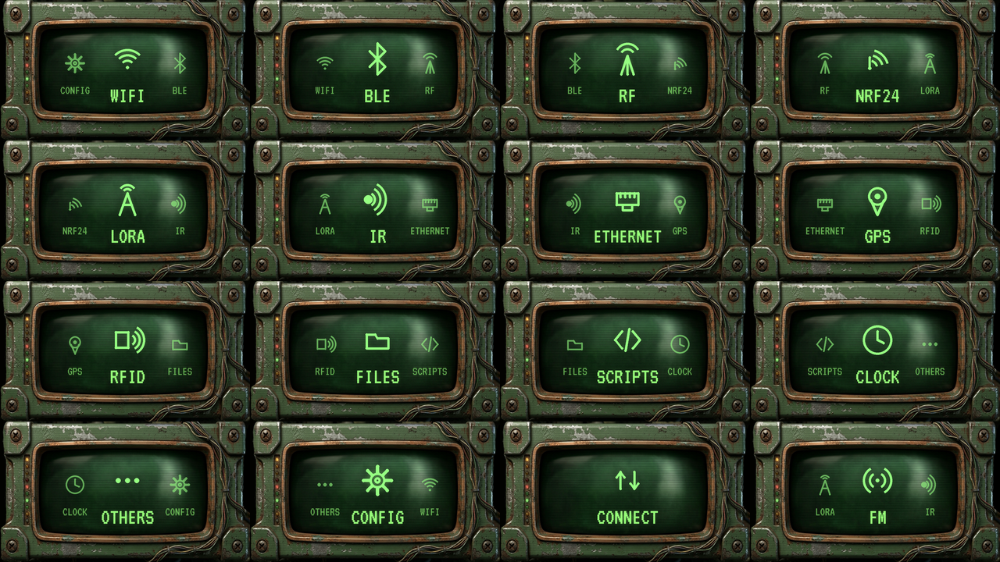

# ☢️ Nuclear Terminal — Bruce Theme

  

> **EN** — A **post-apocalyptic military terminal** UI theme for the **[Bruce firmware](https://github.com/BruceDevices/firmware)** on the LilyGO T-Embed CC1101 (320×170). Battered olive-drab casing, rust, status LEDs and tangled wiring around a dark green CRT. Each screen is a **horizontal carousel**: previous item (small) · **current item** (large) · next item (small), each with its green picto and label.

> **FR** — Un thème UI **terminal militaire post-apo** pour le firmware **[Bruce](https://github.com/BruceDevices/firmware)** sur LilyGO T-Embed CC1101 (320×170). Boîtier vert olive cabossé, rouille, LED d'état et câbles emmêlés autour d'un CRT vert sombre. Chaque écran est un **carrousel horizontal** : menu précédent (petit) · **menu courant** (grand) · menu suivant (petit), chacun avec son picto vert et son libellé.

## 🎮 Rendu / Look

Le libellé du menu est **intégré dans l'image** (`label: 0`) :

- 🟢 **Carrousel horizontal** dans la vitre CRT : picto en haut, texte dessous, sur 3 colonnes.
- 🔆 Colonne **centrale** (courant) plus grande et vive ; **précédent / suivant** plus petits et atténués.
- 📐 Libellés auto-ajustés par colonne → **marges égales**, aucun texte ne mord le cadre.
- ⚙️ 14 pictos verts dessinés à la main : WiFi, BLE, RF, NRF24, LoRa, IR, Ethernet, GPS, RFID, Files, Scripts, Clock, Others, Config (+ FM & Connect).

## 📦 Contenu

`Nuclear_Terminal/` contient **4 tailles** (une par gabarit d'écran Bruce), chacune avec **16 PNG** + son `.json` :

| Dossier | Image | Écran cible |
|---|---|---|
| `105px/` | 240×105 | M5StickC Plus (240×135) |
| `140px/` | 320×140 | **T-Embed CC1101 / Cardputer (320×170)** |
| `180px/` | 320×180 | écrans ~320×210 |
| `192px/` | 320×192 | écrans ~320×222 |

> ℹ️ **Barre d'état** — Bruce réserve **30 px en haut** (batterie / heure / WiFi). La bonne taille = **hauteur de ton écran − 30**. Pour le **T-Embed CC1101 (320×170) → `140px`**. Le firmware place l'image sous la barre d'état, donc les icônes ne mordent pas le cadre et ne clignotent pas au changement de menu.

## 🚀 Installation

1. Copie le dossier **`Nuclear_Terminal`** à la racine de la carte SD.
2. Sur l'appareil : **Config → UI Theme → `Nuclear_Terminal/<taille>/Theme_Nuclear_Terminal.json`** (taille = hauteur écran − 30 ; **`140px` pour le T-Embed CC1101**).
3. Via WiFi : **Files → WebUI**, upload le dossier, puis sélectionne le `.json`.

## ⚠️ Ordre du menu (voisins)

Le carrousel peint les libellés **précédent / suivant** selon l'**ordre par défaut** du menu Bruce T-Embed CC1101 :
`WiFi → BLE → RF → NRF24 → LoRa → IR → Ethernet → GPS → RFID → Files → Scripts → Clock → Others → Config` (en boucle).

Si tu **désactives ou réordonnes** des menus (`Config → Main Menu`), les voisins affichés ne correspondront plus. Ouvre une issue avec ton ordre exact et je régénère le thème pour ta config.

## 🛒 Matériel / Hardware

Accessoires utiles pour ce projet — liens affiliés Amazon :

|  |  |  |
|:---:|:---:|:---:|
| 🔋 **[Anker 545 power bank (10 000 mAh)](https://www.amazon.com/dp/B0D45MSMJR?linkCode=ll2&tag=koua29bnucleartheme-20&ref_=as_li_ss_tl)** Pour faire tourner le T-Embed loin d'une prise | 📡 **[433 MHz SMA antenna (2-pack)](https://www.amazon.com/dp/B0C1FCZM94?linkCode=ll2&tag=koua29bnucleartheme-20&ref_=as_li_ss_tl)** Antenne sub-GHz pour la radio CC1101 | 💾 **[SanDisk 64 GB microSD (2-pack)](https://www.amazon.com/dp/B0B7NVMBPL?linkCode=ll2&tag=koua29bnucleartheme-20&ref_=as_li_ss_tl)** Pour les thèmes, scripts et captures Bruce |

En tant que Partenaire Amazon, je réalise un bénéfice sur les achats remplissant les conditions requises. · As an Amazon Associate I earn from qualifying purchases.

## 🎨 Crédits

- Fond terminal & thème par **koua29**.
- Police de rendu : **[VT323](https://fonts.google.com/specimen/VT323)** (SIL Open Font License).
- Tourne sur l'excellent **[Bruce firmware](https://github.com/BruceDevices/firmware)**.

## ☕ Un café ?

Si ce thème te plaît :

## 📄 Licence

**MIT** — voir [LICENSE](LICENSE). Univers post-apocalyptique d'inspiration ; projet fan non officiel, non affilié.
